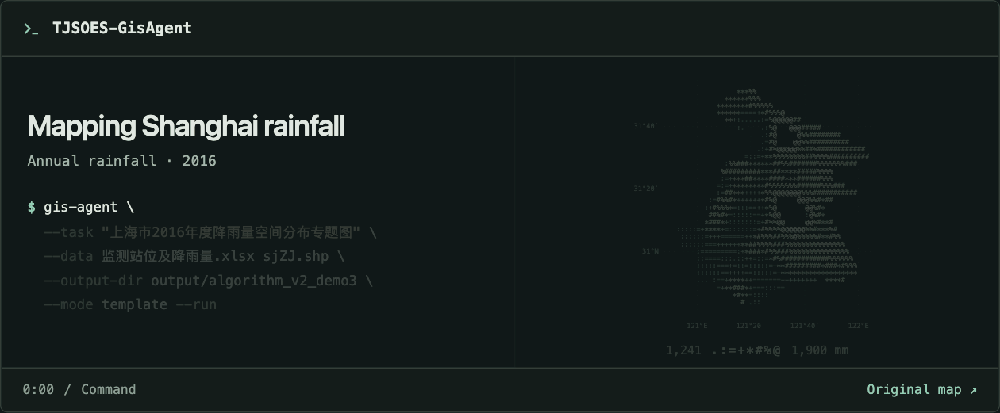
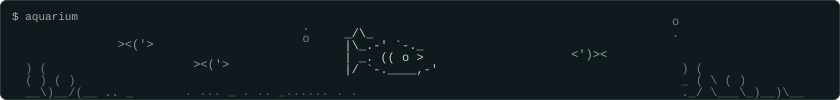
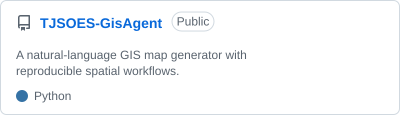
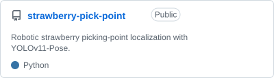
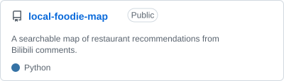

<picture>
  <source media="(max-width: 700px)" srcset="./assets/mobile.svg">
  
</picture>

<a href="https://github.com/kanemaverick/TJSOES-GisAgent/blob/main/assets/rainfall.png">
  <picture>
    <source media="(max-width: 700px) and (prefers-reduced-motion: reduce)" srcset="./assets/gis-demo-mobile.png">
    <source media="(prefers-reduced-motion: reduce)" srcset="./assets/gis-demo.png">
    <source media="(max-width: 700px)" srcset="./assets/gis-demo-mobile.gif">
    
  </picture>
</a>

More about me

- 👋 Hi, I’m @Kane Xie
- 👀 I’m interested in AI and physics
- 🌱 I’m currently learning machine learning from Andrew NG
- 💞️ I’m looking to collaborate on create a embodied robot for underwater tasks.
- 📫 How to reach me:kanemaverickai@gmail.com
- 😄 Pronouns: call me KM
- ⚡ Fun fact: My job is wind, so you gotta feel it.

How the GitHub stats are counted

The card refreshes daily. Uptime starts on the day I joined GitHub. Repos counts public repositories I own, including forks. Stars adds up the stars received by my public non-fork repositories.

Commits and line changes cover my own commits on the default branches of my public non-fork repositories, excluding this profile repository. The two line counts show additions and deletions. Languages are ranked by how many of those repositories use each as their primary language.

<picture>
  <source media="(max-width: 700px)" srcset="./assets/aquarium-mobile.svg">
  
</picture>

### Selected projects

  
  
  

